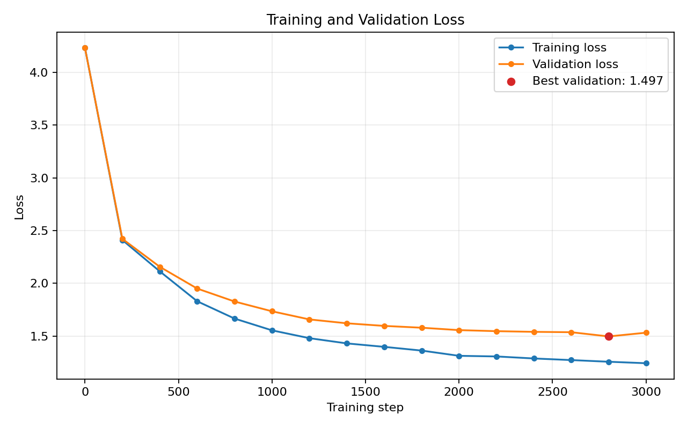

# minGPT

A small character-level GPT implementation in PyTorch. It trains on the
Tiny Shakespeare dataset and can generate Shakespeare-like text.

## Setup

Create and activate a Python environment, then install the dependencies:

```bash
python -m pip install torch numpy matplotlib pytest
```

The project automatically uses CUDA, Apple MPS, or CPU, in that order.

## Prepare the data

```bash
python data/tinyshakespeare/prepare.py
```

This downloads Tiny Shakespeare when `input.txt` is missing and creates:

- `data/tinyshakespeare/train.bin`
- `data/tinyshakespeare/val.bin`
- `data/tinyshakespeare/meta.pkl`

## Train

```bash
python train.py
```

Training settings such as model size, batch size, learning rate, and seed are
defined near the top of `train.py`.

The best checkpoint is saved to `data/tinyshakespeare/model.pt`. Evaluation
history is saved to `data/tinyshakespeare/history.csv`.



Training loss decreased consistently throughout training, while validation loss plateaued during the later iterations. The lowest validation loss was 1.497, suggesting that the model had reached diminishing returns and was beginning to exhibit mild overfitting. The best-performing checkpoint was selected based on validation loss.

Regenerate the plot after training with:

```bash
python plot_history.py
```

## Generate text

```bash
python generate.py --prompt "ROMEO:" --max_new_tok 500
```

Optional generation arguments:

```text
--prompt          Starting text
--max_new_tok     Number of tokens to generate
--temperature     Sampling temperature
--top_k           Number of highest-probability tokens to sample from
```

## Run tests

```bash
python -m pytest -q
```

The model was evaluated using six PyTest unit tests covering:

- Forward pass output shapes
- Cross-entropy loss calculation
- Backpropagation and gradient validity
- Causal attention masking
- Autoregressive text generation
- Checkpoint serialization and restoration

All 6 tests passed on CPU.

## Project structure

```text
model.py                         GPT model and text generation
train.py                         Training and checkpointing
generate.py                      Command-line text generation
devices.py                       CUDA, MPS, or CPU selection
plot_history.py                  Plot saved training history
data/tinyshakespeare/prepare.py  Dataset preparation
test/test_model.py               Model tests
```

If macOS reports a duplicate OpenMP runtime error, run commands with:

```bash
DYLD_LIBRARY_PATH="$CONDA_PREFIX/lib" python train.py
```
